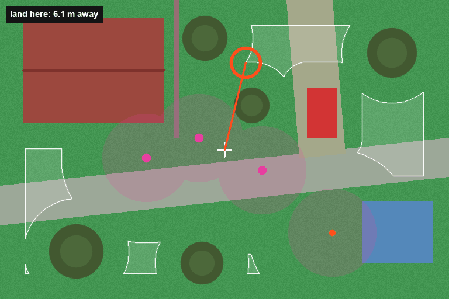
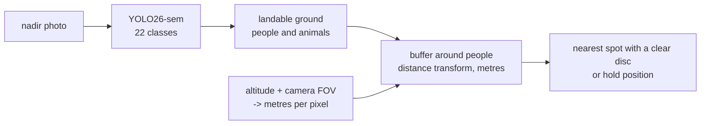

# Drone landing zones

Where can a drone land? A semantic segmentation network labels a nadir photo pixel by pixel
(grass, paved area, roof, tree, water, person, ...), and a rule in metres turns the labels into a
decision: the nearest spot where a disc the size of the drone plus its position error lies on
flat open ground, and nobody is within a safety buffer. If there is no such spot, the drone
holds position.

The network is YOLO26-sem, the newest Ultralytics segmentation model, fine-tuned from its
Cityscapes weights on the [Semantic Drone Dataset](https://ivc.tugraz.at/research-project/semantic-drone-dataset/)
(TU Graz): 400 photos of houses and gardens taken 5-30 m above the ground at 6000 x 4000 px.
The evaluation does not stop at IoU: it checks every landing decision against the hand-labelled
masks.

<p align="center"></p>
<sub>The rule on a synthetic garden seen from above, re-planned every frame. The drone (cross)
needs a clear 1 m disc of ground and keeps 3 m from people (pink) and animals (orange); white
outlines mark where it may land, and the orange ring is the nearest such spot. The scene is drawn,
because the dataset's photos may not be redistributed.</sub>



## How the decision is made

- **Classes to categories.** Paved area, dirt, grass and gravel (and the printed AR markers
  lying on them) are landable. People and dogs get a buffer. Everything else, from roofs and
  trees to water and bicycles, is simply not landable.
- **Metres, not pixels.** The ground sampling distance follows from the altitude and the
  camera's horizontal field of view, `GSD = 2 h tan(FOV / 2) / width`. The same photo from 30 m
  needs a disc six times smaller in pixels than from 5 m.
- **Clearance.** The Euclidean distance transform of the landable mask (after removing the
  buffer around every person) gives, for every pixel, the radius of the largest clear disc
  around it. Candidates have a radius of at least `clearance_m` (default 1 m: a small quadcopter
  plus its position error). The image border counts as unknown, so a spot at the edge needs its
  clearance inside the picture.
- **Nearest, not largest.** The drone takes the candidate closest to the point below it, the
  shortest diversion. With no candidate it holds position and climbs for a wider view.
- **A planning margin.** Candidates keep an extra 0.75 m from obstacles and buffers, so a
  segmentation boundary that is a few centimetres off cannot put the drone next to a person.
- **Checked against its own map.** A property test draws random scenes and asserts that every
  chosen site passes the safety check on the map it was chosen from. The buffer carries one pixel
  of margin, so the guarantee holds exactly at pixel level.

## Results

Held-out test images (80 photos in blocks of 10 consecutive ones, so no near-duplicate of a test
image is in training), 1536 x 1024 px at a nominal 2 cm per pixel, 1 m clearance, 3 m buffer:

| Model | mIoU | IoU landable ground | IoU people and animals | ms / image |
|---|---|---|---|---|
| YOLO26n-sem | 69.4 | 93.6 | 67.7 | 61 |
| YOLO26s-sem | 69.9 | **94.0** | **71.4** | 56 |

Landing decisions with YOLO26s-sem, judged against the hand-labelled masks:

| Policy | Safe | Unsafe | Holds position | Median diversion |
|---|---|---|---|---|
| straight down, no camera | 37.5 % | 62.5 % | - | 0 m |
| nearest predicted ground pixel | 37.5 % | 62.5 % | - | 0 m |
| clear disc + buffer, no margin | 51.2 % | 48.7 % | - | 1.0 m |
| clear disc + buffer, 0.25 m margin | 86.3 % | 13.8 % | - | 1.7 m |
| clear disc + buffer, 0.5 m margin | 90.0 % | 10.0 % | - | 2.1 m |
| **clear disc + buffer, 0.75 m margin (default)** | **93.8 %** | **6.2 %** | - | 3.6 m |
| clear disc + buffer, 1 m margin | 87.5 % | 6.2 % | 6.2 % | 3.8 m |

A decision is safe when the labelled disc around the chosen spot is all landable ground and
nobody is closer than the buffer; unlabelled pixels count as unsafe. The labelled masks have a
safe spot in every test photo.

- **The camera matters:** descending where the drone happens to be is safe in only 38 % of these
  gardens and yards. With the rule, 94 % of the decisions are safe, for a median diversion of
  3.6 m.
- **Plan with a margin.** The rule plans on the network's map, whose boundaries are a few
  centimetres off; a candidate exactly at the edge of the allowed area then touches a person's
  buffer or an obstacle in the real scene. Planning as if every obstacle and buffer were 0.75 m
  wider keeps the chosen spot clear of those errors. The margin was chosen on the validation
  photos (40), and the table above is the untouched test set. A wider margin starts to hold
  position where a safe spot exists.
- **The small model is close behind:** YOLO26n-sem, the one for an onboard computer, gives 86 %
  safe decisions with its own validation-chosen margin of 1 m.

## Quickstart

```bash
pip install -e ".[train]"
bash scripts/download_models.sh          # Cityscapes-pretrained YOLO26-sem weights
bash scripts/download_data.sh            # Semantic Drone Dataset (TU Graz)
landing-prepare --raw data/SemanticDroneDatasetPublic/semantics --out data/landing   # 1536 x 1024 + data.yaml
landing-train --data data/landing/data.yaml --model yolo26s-sem.pt --name sdd_yolo26s --epochs 150
landing-eval --model runs/sdd_yolo26s/weights/best.pt --data data/landing/data.yaml --split test
landing-predict --model runs/sdd_yolo26s/weights/best.pt --source photos/ --altitude 20 --hfov 84
```

`landing-predict` writes an overlay per photo (landable ground green, everything else red,
people magenta, candidate areas outlined, the chosen spot as a ring) and `decisions.json` with
the site in pixels, its clearance and its distance in metres.

## Training on a GPU cluster (Slurm)

```bash
bash scripts/setup_cluster.sh && bash scripts/download_models.sh && bash scripts/download_data.sh
python3 slurm/generate.py prepare --submit     # CPU
python3 slurm/generate.py train --submit       # array: YOLO26n-sem (onboard) and YOLO26s-sem
python3 slurm/generate.py evaluate --submit
```

Account and paths come from `slurm/cluster.toml`; put your account in the git-ignored
`slurm/cluster.local.toml`. Downloads run on a login node, jobs run offline.

## Project layout

```
src/landing/
  classes.py     dataset classes -> landable / living / ignored
  data.py        Semantic Drone Dataset -> Ultralytics semantic layout, block split
  zones.py       GSD, clearance map, site choice, safety check
  train.py       Ultralytics fine-tuning with resume
  evaluate.py    IoU and landing decisions of three policies against the labels
  predict.py     overlays and decisions for new photos
  visualize.py   the overlay
```

## Data and licence

The code is MIT-licensed. The Semantic Drone Dataset is free for non-commercial research and
education, must be cited, and may not be redistributed, so it is downloaded by the script and
never committed. Trained weights are derived from it and are not published for commercial use.

## References

- Semantic Drone Dataset, Institute of Computer Graphics and Vision, TU Graz.
- Ultralytics YOLO26 (2026), semantic segmentation models pretrained on Cityscapes.
